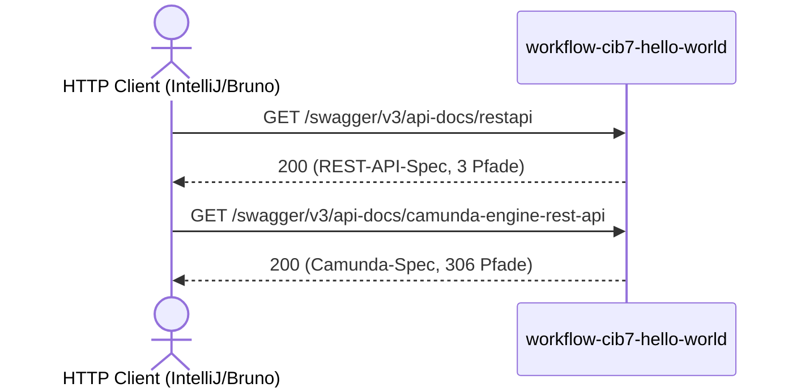

# OpenAPI Spec Flow: REST API + Camunda Engine REST

Datei: `httprequest/restapi/openapi-spec-flow/openapi-spec-flow.http`

## Ziel

Die beiden OpenAPI-Spezifikationen direkt aus der laufenden Anwendung abrufen. Damit stehen die
kompletten Contracts in Bruno zur Verfuegung, ohne alle Operationen als einzelne Requests zu
importieren.

## Ablauf (Services)

## Requests (in dieser Reihenfolge)

1. `restapi` – Springdoc-Gruppe `restapi` (`/restapi/ping`, `/restapi/camunda`, `/restapi/workflow`).
2. `camunda-engine-rest-api` – gemergte Camunda-Engine-REST-Spec (`/engine-rest/**`).

## Benoetigte Variablen

|      Variable       |             Quelle             |    Verwendung     |
|---------------------|--------------------------------|-------------------|
| `host`              | `http-client.env.json`         | Basis-URL         |
| `traceId`, `spanId` | `../../scripts/traceparent.js` | Trace-Korrelation |

## Asserts

- `restapi` → `200`, `openapi` gesetzt, die drei REST-Pfade vorhanden.
- `camunda-engine-rest-api` → `200`, `/version` vorhanden, mehr als 100 Pfade.

## Hinweise

- Die gleichen Specs werden im Maven-Build nach `target/openapi/` geschrieben und als Artefakte
  `json:openapi-restapi` bzw. `json:openapi-camunda-engine-rest-api` publiziert.
- Die Endpunkte sind ohne Basic Auth erreichbar.

