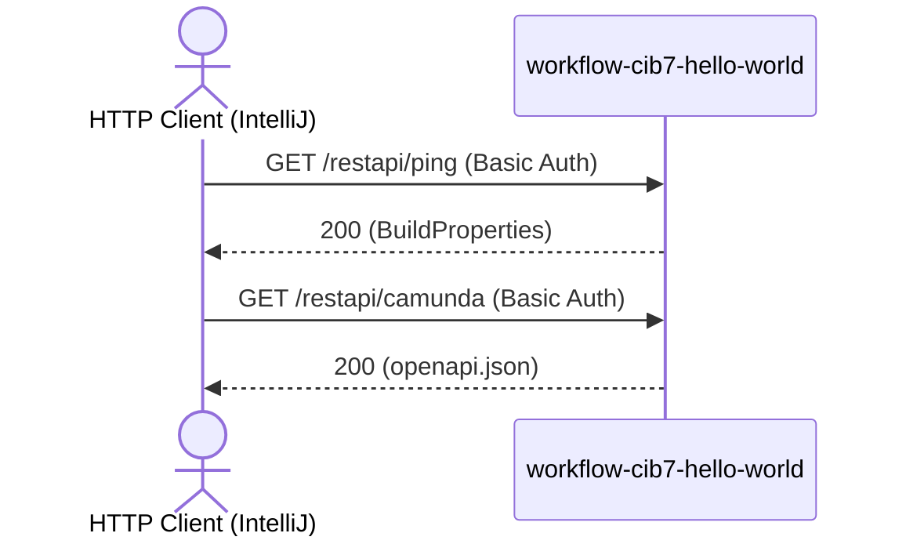

# REST API Smoke Flow: ping -> camunda

Datei: `httprequest/restapi/restapi-smoke-flow/restapi-smoke-flow.http`

## Ziel

Die beiden schreibfreien Controller-Endpunkte der Anwendung pruefen: Build-Informationen
(`PingRestController`) und das eingebettete Camunda-OpenAPI-Dokument
(`CamundaOpenApiRestController`).

## Ablauf (Services)

## Requests (in dieser Reihenfolge)

1. `ping` – liefert Gruppe, Artefakt, Version und Git-Commit der Anwendung.
2. `camunda` – liefert das OpenAPI-Dokument der Camunda Engine REST API.

## Benoetigte Variablen

|        Variable        |             Quelle             |    Verwendung     |
|------------------------|--------------------------------|-------------------|
| `host`                 | `http-client.env.json`         | Basis-URL         |
| `username`, `password` | `http-client.private.env.json` | Basic Auth        |
| `traceId`, `spanId`    | `../../scripts/traceparent.js` | Trace-Korrelation |

## Asserts

- `ping` → `200`, `mavenGroupdId`, `mavenArtifactId`, `version` und `gitCommitId` gesetzt.
- `camunda` → `200`, `openapi` und `paths` im Dokument vorhanden.

## Hinweise

- Beide Endpunkte sind durch Spring Security geschuetzt (Basic Auth).
- Das Profil `local` oder `k8s` in IntelliJ auswaehlen.

