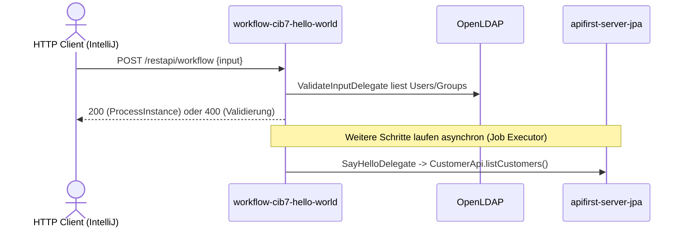

# Workflow Flow: hello-world-process ueber `/restapi/workflow` starten

Datei: `httprequest/restapi/workflow-flow/workflow-flow.http`

## Ziel

Alle Controller-Varianten des Prozessstarts pruefen: Default-Pfad, die beiden benannten
Gateway-Branches (`eder`, `pumukel`), den Fehlerpfad (`fail`) sowie die beiden
Validierungsfehler (fehlendes und leeres `input`).

## Ablauf (Services)

## Requests (in dieser Reihenfolge)

| # |        Request         |  `input`  |            Erwartung            |
|---|------------------------|-----------|---------------------------------|
| 1 | default branch         | `hallo`   | `200`, Prozessinstanz angelegt  |
| 2 | gateway branch Eder    | `eder`    | `200`, Prozessinstanz angelegt  |
| 3 | gateway branch Pumukel | `pumukel` | `200`, Prozessinstanz angelegt  |
| 4 | delegate error path    | `fail`    | `200`, Prozessinstanz angelegt  |
| 5 | missing input          | fehlt     | `400` (Bean Validation)         |
| 6 | empty input            | `""`      | `400` (`ValidateInputDelegate`) |

## Benoetigte Variablen

|        Variable        |             Quelle             |    Verwendung     |
|------------------------|--------------------------------|-------------------|
| `host`                 | `http-client.env.json`         | Basis-URL         |
| `username`, `password` | `http-client.private.env.json` | Basic Auth        |
| `traceId`, `spanId`    | `../../scripts/traceparent.js` | Trace-Korrelation |

## Asserts

- Requests 1–4: `200`, `processDefinitionId` beginnt mit `hello-world-process`, `processInstanceId` gesetzt.
- Requests 5–6: `400`.

## Hinweise

- Der Prozessstart ruft `ValidateInputDelegate` synchron auf; dieser benoetigt LDAP
  (`docker compose up -d ldap` bzw. der Kubernetes-Stack).
- Nach dem Start laufen Script-, External-Task- und User-Task-Schritte asynchron. Der Request
  prueft daher nur den erfolgreichen Start, nicht das Prozessende.
- Der `fail`-Pfad wird erst im `SayHelloDelegate` nach Abschluss des User Tasks ausgeloest; der
  Controller antwortet trotzdem mit `200`, weil der Prozess zu diesem Zeitpunkt bereits laeuft.
- Der Default-Pfad setzt `User03` auf `Default`, die Branches auf `Eder` bzw. `Pumukel`
  (`Set_User03_*`-ScriptTasks im BPMN).

