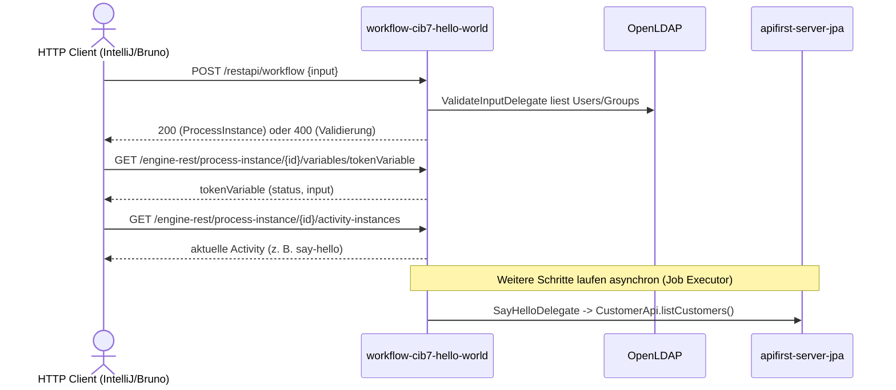

# Workflow Flow: hello-world-process starten und Token-Position verifizieren

Datei: `httprequest/restapi/workflow-flow/workflow-flow.http`

## Ziel

Alle Controller-Varianten des Prozessstarts pruefen: Default-Pfad, die beiden benannten
Gateway-Branches (`eder`, `pumukel`), den Fehlerpfad (`fail`) sowie die beiden
Validierungsfehler (fehlendes und leeres `input`).

Zusaetzlich wird nach jedem erfolgreichen Start ueber die Camunda-Engine-REST-API geprueft,
wo der Token im Prozess steht: die `tokenVariable` (Status + Input) und die aktuelle
Activity-Instanz.

## Ablauf (Services)

## Requests (in dieser Reihenfolge)

| #  |           Request            |  `input`  |               Erwartung                |
|----|------------------------------|-----------|----------------------------------------|
| 1  | default start                | `hallo`   | `200`, Prozessinstanz angelegt         |
| 2  | default token variable       | –         | `200`, Status gesetzt, Input `hallo`   |
| 3  | default token activity       | –         | `200`, aktuelle Activity vorhanden     |
| 4  | gateway branch Eder start    | `eder`    | `200`, Prozessinstanz angelegt         |
| 5  | Eder token variable          | –         | `200`, Status gesetzt, Input `eder`    |
| 6  | Eder token activity          | –         | `200`, aktuelle Activity vorhanden     |
| 7  | gateway branch Pumukel start | `pumukel` | `200`, Prozessinstanz angelegt         |
| 8  | Pumukel token variable       | –         | `200`, Status gesetzt, Input `pumukel` |
| 9  | Pumukel token activity       | –         | `200`, aktuelle Activity vorhanden     |
| 10 | delegate error path start    | `fail`    | `200`, Prozessinstanz angelegt         |
| 11 | fail token variable          | –         | `200`, Status gesetzt, Input `fail`    |
| 12 | fail token activity          | –         | `200`, aktuelle Activity vorhanden     |
| 13 | missing input                | fehlt     | `400` (Bean Validation)                |
| 14 | empty input                  | `""`      | `400` (`ValidateInputDelegate`)        |

## Token-Verifikation

Die `tokenVariable` wird im `ValidateInputDelegate` erzeugt und durchlaeuft folgende Status:

|        Status        |                Bedeutung                 |
|----------------------|------------------------------------------|
| `STARTED`            | Token nach der Input-Validierung erzeugt |
| `RUNNING`            | Token im External Task (`sayHelloTopic`) |
| `COMPLETED`          | User Task `say-hello` abgeschlossen      |
| `FINISHED`           | Prozess erfolgreich beendet              |
| `BUSINESS_EXCEPTION` | Fehlerpfad (`fail`)                      |

Die Activity-Abfrage liefert die aktuelle Position, z. B. `Service_for_Script`,
`External_Task`, `say-hello` oder `Activity_say_hello-via_delegate`. Im Regelfall steht der
Token nach dem Start am User Task `say-hello` (Status `RUNNING`).

## Asserts

- Starts 1, 4, 7, 10: `200`, `processDefinitionId` beginnt mit `hello-world-process`,
  `processInstanceId` gesetzt und als `{{processInstanceId}}` gespeichert.
- Token-Requests: `200`, gueltiger Status, erwarteter Input.
- Activity-Requests: `200`, aktuelle Activity/Transition vorhanden, gleiche Prozessinstanz.
- Requests 13–14: `400`.

## Hinweise

- Der Prozessstart ruft `ValidateInputDelegate` synchron auf; dieser benoetigt LDAP
  (`docker compose up -d ldap` bzw. der Kubernetes-Stack).
- Nach dem Start laufen Script-, External-Task- und User-Task-Schritte asynchron. Die
  Token-/Activity-Pruefung ist daher tolerant formuliert und akzeptiert die jeweilige
  Zwischenposition. In CI sorgt `bru run ... --delay 6000` dafuer, dass der Token in der
  Regel bereits am User Task `say-hello` steht.
- Der `fail`-Pfad wird erst im `SayHelloDelegate` nach Abschluss des User Tasks ausgeloest;
  der Controller antwortet trotzdem mit `200`, weil der Prozess zu diesem Zeitpunkt bereits laeuft.
- Der Default-Pfad setzt `User03` auf `Default`, die Branches auf `Eder` bzw. `Pumukel`
  (`Set_User03_*`-ScriptTasks im BPMN).

